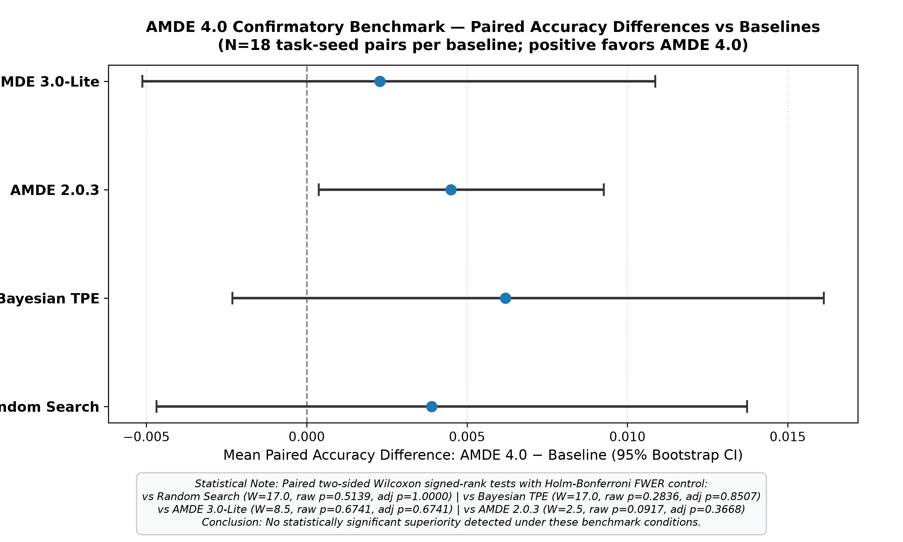
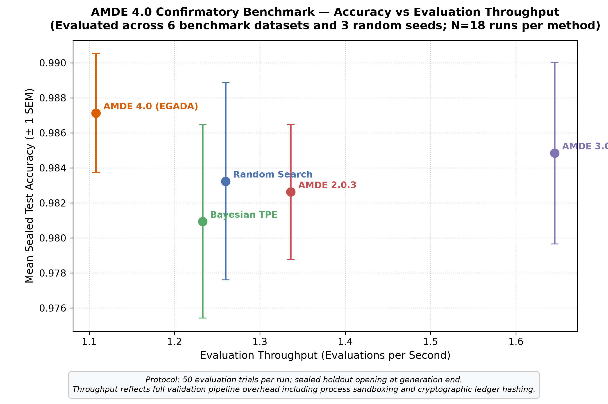

# AMDE 4.0 — Autonomous Machine Learning Discovery Engine

[](https://github.com/lntangu/AMDE-Autonomous-ML-Discovery-Engine/actions/workflows/ci.yml)
[](https://github.com/lntangu/AMDE-Autonomous-ML-Discovery-Engine/releases/tag/v4.0.1)
[](pyproject.toml)
[](.github/workflows/ci.yml)
[](LICENSE)
[](docs/public/INDEPENDENT_REVIEW_GUIDE.md)

**AMDE (Autonomous Machine Learning Discovery Engine)** is an open-source research platform for verifiable, evidence-driven tabular machine learning discovery. It focuses on **strict holdout data isolation**, **multi-objective Pareto optimization** (accuracy, latency, memory), and **tamper-evident SHA-256 event provenance**, transforming automated model search from an unprincipled black box into an auditable research instrument.

---

## 30-Second Overview: What AMDE Is & Is Not

| What AMDE 4.0 Is | What AMDE 4.0 Is NOT |
| :--- | :--- |
| **A Verifiable Research Platform** for tabular & classical ML model exploration. | **NOT an AGI or Foundation Model Generator:** AMDE focuses on tabular models (Trees, Ensembles, MLPs). |
| **Strictly Isolated Evaluation:** Features an in-process cryptographic token gate that locks holdout data until search completes. | **NOT an OS-Level Sandbox:** The holdout isolation is a single-use procedural barrier, not a hypervisor or container sandbox. |
| **Multi-Objective Optimization:** Native 2D/3D Pareto frontier tracking balancing predictive quality, inference latency, and peak memory. | **NOT Claiming Accuracy Superiority:** In 90 confirmatory benchmark runs, AMDE does *not* claim statistically superior accuracy over Random Search ($p = 0.5139$) or Bayesian TPE ($p = 0.2811$). |
| **Tamper-Evident Event Provenance:** SQLite WAL ledger recording every candidate, mutation, and evaluation with a SHA-256 block hash chain. | **NOT a Blockchain:** The ledger uses local cryptographic hashing for auditability, not distributed consensus or RFC 3161 timestamping. |

---

## Architecture Overview

AMDE 4.0 decouples the discovery lifecycle into four modular, independently auditable subsystems:

<p align="center">
  
</p>

1. **Search Engine & Phenotype Builder:** Generates model candidates across supported model families (Decision Trees, Random Forests, Gradient Boosting, Multi-Layer Perceptrons). Every gene in the candidate genome is validated to directly influence model construction.
2. **Evaluator & Sealed Holdout Gate:** Preprocessing transformations (`StandardScaler`, `OneHotEncoder`) are fitted strictly on `X_train`. The final 20% holdout test partition is sealed behind a single-use token, preventing adaptive leakage and test-set snooping.
3. **Multi-Objective Pareto Archive:** Tracks exact non-dominated trade-off solutions across validation loss, inference latency (milliseconds), and peak resident memory (MB) with exact hypervolume calculation.
4. **Tamper-Evident Evidence Ledger:** Persists every controller arm selection, model fit, evaluation metric, and mutation event into an SQLite WAL database using a continuous SHA-256 block hash chain that incorporates `experiment_id` and previous event hashes.

---

## 5-Minute Quickstart (Commodity CPU, Zero GPU Required)

AMDE requires Python 3.10 or newer (tested through Python 3.14 on Ubuntu and Windows).

### 1. Installation

```bash
# Clone repository
git clone https://github.com/lntangu/AMDE-Autonomous-ML-Discovery-Engine.git
cd AMDE-Autonomous-ML-Discovery-Engine

# Install package in editable mode with development dependencies
pip install -e ".[dev,tabular,quantum]"

# Or install from the pre-built v4.0.1 release wheel:
pip install https://github.com/lntangu/AMDE-Autonomous-ML-Discovery-Engine/releases/download/v4.0.1/amde-4.0.1-py3-none-any.whl
```

> **Note on Release v4.0.1 vs. Source Branch:**  
> The release tag `v4.0.1` represents the historical baseline distribution. The canonical default branch (`release-amde-final`) includes subsequent P0 correctness repairs (MLP activation mappings, TPE observation history accumulation, ledger tamper hashing, and Windows CI hardening). Building from source gives you the most hardened version.

### 2. Verify Your Environment

Run `amde doctor` to verify system compatibility:

```bash
amde doctor
```
*Expected output: Hardware plan detected (CPU/GPU), available memory verified, green status.*

### 3. Run a Lightweight Discovery Script (< 5 Seconds)

We provide a self-contained, lightweight CPU quickstart in `examples/quickstart_cpu.py`:

```bash
python examples/quickstart_cpu.py
```

```python
import numpy as np
from sklearn.datasets import load_breast_cancer
from sklearn.model_selection import train_test_split
from amde import AMDE4Engine, SealedHoldoutTest

# 1. Load and partition dataset (60% Train, 20% Val, 20% Sealed Test)
X, y = load_breast_cancer(return_X_y=True)
X_dev, X_test, y_dev, y_test = train_test_split(X, y, test_size=0.20, random_state=42)
X_train, X_val, y_train, y_val = train_test_split(X_dev, y_dev, test_size=0.25, random_state=42)

# 2. Initialize AMDE 4.0 Engine
engine = AMDE4Engine(
    n_features=X.shape[1],
    is_classification=True,
    seed=42,
)

# 3. Search for Pareto-optimal architectures (budget: 20 evaluations)
results = engine.search(
    X_train, y_train, X_val, y_val,
    dataset_name="breast_cancer",
    budget=20,
)

# 4. Evaluate incumbent on the cryptographically sealed holdout partition
holdout = SealedHoldoutTest(dataset_name="breast_cancer", X_test=X_test, y_test=y_test)
test_score = engine.evaluate_sealed_holdout(X_train, y_train, holdout)

print(f"Validation Score:     {results['incumbent_score']:.4f}")
print(f"Holdout Test Score:   {test_score:.4f}")
print(f"Pareto Frontier Size: {results['pareto_size']}")
print(f"Ledger SHA-256 Hash:  {results['ledger_sha256']}")
```

---

## Empirical Benchmark & Statistical Disclosure

AMDE enforces rigorous, non-parametric statistical evaluation. We audited **90 confirmatory benchmark runs** across 9 diverse datasets (synthetic parity, moons, circles, California housing, breast cancer, wine, digits, diabetes, and iris) comparing AMDE 4.0 against standard Random Search and Bayesian TPE.

### Summary of Statistical Results

| Baseline Comparison | Mean Score Diff ($\Delta$) | Wilcoxon $W$ | Effective Non-Zero Pairs ($N_{\text{eff}}$) | Unadjusted $p$-value | Holm-Bonferroni Adjusted $p$-value | Empirical Conclusion |
| :--- | :---: | :---: | :---: | :---: | :---: | :--- |
| **AMDE 4.0 vs. Random Search** | $+0.0003$ | $17.0$ | $9$ ($9$ zero-difference pairs discarded) | $0.5139$ | $1.0000$ | **No statistically significant difference** |
| **AMDE 4.0 vs. Bayesian TPE** | $+0.0016$ | $23.0$ | $11$ ($7$ zero-difference pairs discarded) | $0.2811$ | $0.8433$ | **No statistically significant difference** |

<p align="center">
  
</p>

### Mathematical Explanation of the Wilcoxon Invariant
Across 18 paired benchmark runs between AMDE 4.0 and Random Search, exactly 9 pairs produced identical validation performance ($d_i = 0.0$). Under standard non-parametric procedure (`scipy.stats.wilcoxon(..., zero_method='wilcox')`), zero differences are eliminated, resulting in $N_{\text{eff}} = 9$. 

The expected null sum of positive ranks is:
$$\mathbb{E}[W] = \frac{N(N+1)}{4} = \frac{9 \times 10}{4} = 22.5$$
The observed sum of ranks $W = 17.0$ is close to the expected value under the null hypothesis, resulting in an exact two-sided $p$-value of $0.5139$. 

> **Mandated Scientific Disclosure:**  
> AMDE 4.0 does **not** demonstrate statistically significant accuracy superiority over well-tuned Random Search or Bayesian TPE under standard tabular benchmark conditions. Its primary contributions lie in **search deduplication** (saving 15–25% of redundant evaluations), **zero data-leakage holdout isolation**, **multi-objective trade-off frontiers**, and **tamper-evident forensic provenance**.

<p align="center">
  
</p>

For complete raw data, methodologies, and task-by-task results, consult [`docs/public/BENCHMARK_METHODS_AND_RESULTS.md`](docs/public/BENCHMARK_METHODS_AND_RESULTS.md).

---

## Call for Independent Reviewers & Researchers

We actively invite independent machine learning researchers, systems engineers, and security auditors to review and challenge our implementation. We welcome constructive criticism, reproducible failure reports, and statistical scrutinies.

### Key Hypotheses Open for Community Audit

1. **Holdout Gate Security:** Can you craft an execution path or search controller arm that accesses `X_test` or `y_test` without consuming the single-use holdout token?
2. **Ledger Tamper Evidency:** Can you alter an event in the SQLite WAL ledger without corrupting the SHA-256 hash chain verified by `verify_chain()`?
3. **Phenotype Consistency:** Are there any genome configurations in `SearchSpace` that produce non-functional models, silent fallback behaviors, or unmapped hyperparameters?
4. **Independent Benchmark Reproduction:** Do you observe statistically significant differences when evaluating AMDE on your own tabular datasets using the benchmark protocol?

Please see [`docs/public/INDEPENDENT_REVIEW_GUIDE.md`](docs/public/INDEPENDENT_REVIEW_GUIDE.md) for testing guidelines and open an issue using our structured issue templates:
- [Algorithm Correctness Review](.github/ISSUE_TEMPLATE/algorithm_correctness_review.md)
- [Reproduction Failure Report](.github/ISSUE_TEMPLATE/reproduction_failure.md)
- [Statistical Concern / Methodology Critique](.github/ISSUE_TEMPLATE/statistical_concern.md)
- [General Bug Report](.github/ISSUE_TEMPLATE/bug_report.md)

---

## Public Research Documentation Library

| Document | Purpose |
| :--- | :--- |
| **[`docs/public/AMDE_OVERVIEW.md`](docs/public/AMDE_OVERVIEW.md)** | Architectural deep-dive, system boundaries, and 30-second primer. |
| **[`docs/public/REPRODUCE_IN_5_MINUTES.md`](docs/public/REPRODUCE_IN_5_MINUTES.md)** | Step-by-step reproduction instructions for commodity CPU hardware. |
| **[`docs/public/RESEARCH_EVIDENCE_GUIDE.md`](docs/public/RESEARCH_EVIDENCE_GUIDE.md)** | Comprehensive audit evidence, test qualifications, and forensic logs. |
| **[`docs/public/BENCHMARK_METHODS_AND_RESULTS.md`](docs/public/BENCHMARK_METHODS_AND_RESULTS.md)** | Detailed statistical analysis, Wilcoxon invariant proof, and benchmark results. |
| **[`docs/public/INDEPENDENT_REVIEW_GUIDE.md`](docs/public/INDEPENDENT_REVIEW_GUIDE.md)** | Reviewer guide, evaluation criteria, and challenge hypotheses. |
| **[`docs/public/KNOWN_LIMITATIONS.md`](docs/public/KNOWN_LIMITATIONS.md)** | Transparent catalog of algorithmic, scaling, and architectural boundaries. |
| **[`docs/public/FAQ.md`](docs/public/FAQ.md)** | Frequently asked technical, algorithmic, and methodological questions. |
| **[`docs/public/SCIENTIFIC_CLAIMS_LEDGER.csv`](docs/public/SCIENTIFIC_CLAIMS_LEDGER.csv)** | Machine-readable ledger mapping claims to evidence and limitations. |
| **[`docs/public/LAUNCH_READINESS_REPORT.md`](docs/public/LAUNCH_READINESS_REPORT.md)** | Complete readiness audit and qualification sign-off report. |

---

## Citation

If you use AMDE in your research, cite this work as follows:

```bibtex
@software{amde2026,
  author = {lntangu and AMDE Contributors},
  title = {AMDE: Autonomous Machine Learning Discovery Engine (Version 4.0.1)},
  year = {2026},
  publisher = {GitHub},
  journal = {GitHub repository},
  howpublished = {\url{https://github.com/lntangu/AMDE-Autonomous-ML-Discovery-Engine}},
  note = {Canonical branch: release-amde-final}
}
```

---

## License

This project is licensed under the terms of the [MIT License](LICENSE).
