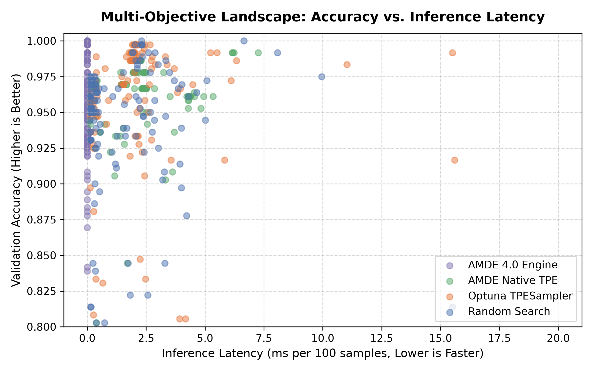

# AMDE — Autonomous Machine Learning Discovery Engine (v5.0.0 Super Learner)

[](https://github.com/lntangu/AMDE-Autonomous-ML-Discovery-Engine/actions/workflows/ci.yml)
[](https://github.com/lntangu/AMDE-Autonomous-ML-Discovery-Engine/releases/tag/v5.0.0)
[](https://pypi.org/project/amde-automl/)
[](pyproject.toml)
[](.github/workflows/ci.yml)
[](LICENSE)
[](https://colab.research.google.com/github/lntangu/AMDE-Autonomous-ML-Discovery-Engine/blob/release-amde-final/notebooks/AMDE_Real_World_Demo.ipynb)

**AMDE (Autonomous Machine Learning Discovery Engine)** is an enterprise-grade research and production AutoML platform for reproducible, multi-objective exploration, dynamic stacking ensemble learning, and forensic evaluation of tabular machine learning pipelines.

AMDE v5.0 introduces the **Dynamic Stacking Ensemble ("Super Learner")**, unifying the Holy Trinity of gradient boosted trees (**LightGBM + XGBoost + CatBoost**) alongside Deep MLPs, Tree Ensembles (Random Forests/ExtraTrees), and Regularized Linear Classifiers under a calibrated meta-learner.

---

## 1. What AMDE Does

AMDE automates the search, evaluation, and selection of machine learning pipelines for tabular datasets:
- **Dynamic Stacking Ensemble (Super Learner):** In AMDE 5.0, rather than returning a single model, AMDE extracts Top-$K$ ($K=5$) diverse Pareto candidates across distinct model families, computes zero-leakage probability distributions, and trains an L2-penalized meta-learner before full refit.
- **The Holy Trinity of Gradient Boosting:** Natively integrates LightGBM, XGBoost, and CatBoost with high-speed histogram tree methods.
- **Multi-Objective Pareto Optimization:** Simultaneously optimizes predictive accuracy, inference latency (milliseconds), and peak resident memory (MB) to construct a non-dominated Pareto trade-off frontier.
- **Token-Gated Sealed Holdout:** Protects the 20% holdout test partition behind a single-use token-gated workflow barrier to prevent accidental test-set snooping during search.
- **Cryptographic Provenance Ledger:** Logs every proposal, mutation, fit, and metric in an append-only, tamper-evident SQLite Write-Ahead Logging (WAL) event ledger with SHA-256 block hashing.
- **Zero Duplicate Proposals:** Caches and deduplicates candidate genomes with hash-based filtering to eliminate redundant model training.
- **Scikit-Learn Standard API:** 100% Scikit-Learn estimator & classifier compliance via `AMDEClassifier` (`is_classifier(clf) == True`).

> **Scope Boundary & Boundary Disclosures:** AMDE is designed for classical tabular datasets and standard CPU environments. It is **not** an AGI system, not a deep learning foundation model generator, not an OS/VM sandbox, and not a distributed blockchain. The sealed holdout gate is an **in-process Python workflow check** sharing memory space with the search runner; it does not provide OS-level or hardware-enclave process isolation, and cannot prevent information leakage if the user runs multiple independent search sessions against the same test partition.

---

## 2. How the Discovery Loop Works

AMDE operates an iterative, state-tracked discovery loop:

```
┌─────────────────────────────────────────────────────────────────────────┐
│                           AMDE Discovery Loop                           │
└─────────────────────────────────────────────────────────────────────────┘
                                     │
                                     ▼
                      ┌─────────────────────────────┐
                      │    Candidate Generation     │
                      │  (Random, TPE, Evolutionary)│
                      └─────────────────────────────┘
                                     │
                                     ▼
                      ┌─────────────────────────────┐
                      │   Candidate Deduplication   │
                      │   (Genome Hash Cache Filter)│
                      └─────────────────────────────┘
                                     │
                                     ▼
                      ┌─────────────────────────────┐
                      │    Isolated Evaluation      │
                      │  (Train Fit -> Val Scoring) │
                      │  (Isolated Preprocess)      │
                      └─────────────────────────────┘
                                     │
                                     ▼
                      ┌─────────────────────────────┐
                      │    Multi-Objective Update   │
                      │   (Pareto Frontier Archive) │
                      └─────────────────────────────┘
                                     │
                                     ▼
                      ┌─────────────────────────────┐
                      │    Evidence Ledger Record   │
                      │  (SQLite WAL SHA-256 Chain) │
                      └─────────────────────────────┘
                                     │
                                     ▼
                      ┌─────────────────────────────┐
                      │    Adaptive Meta-Control    │
                      │  (Strategy Reward Feedback) │
                      └─────────────────────────────┘
                                     │
                       (Repeat until budget exhausted)
                                     │
                                     ▼
                      ┌─────────────────────────────┐
                      │   Sealed Holdout Gate Test  │
                      │  (Single-Use Token Access)  │
                      └─────────────────────────────┘
```

---

## 3. Core Architecture

AMDE decouples the pipeline discovery lifecycle into modular components:

1. **`amde.space.search_space.SearchSpace`:** Defines typed hierarchical genomes spanning 5 distinct model families:
   - **LightGBM (`lgbm`):** `lightgbm.LGBMClassifier` with `n_estimators`, `max_depth`, `learning_rate`, `num_leaves`, and `subsample`.
   - **Tree Ensembles (`tree_ensemble`):** `RandomForestClassifier` and `GradientBoostingClassifier`.
   - **Multi-Layer Perceptrons (`mlp`):** `MLPClassifier` with hidden dimensions, activations, regularization, and optimizers.
   - **Linear Models (`linear`):** `LogisticRegression` with L2 or unregularized/none penalty mapped via `solver="lbfgs"`.
   - **Kernel Support Vector Classifiers (`kernel_svc`):** mapped to `sklearn.svm.SVC(C=1/alpha)`; `kernel_ridge` is retained as a deprecated alias.
   - **Preprocessing stages:** (imputers, scalers, feature selectors) calibrated strictly on `X_train`.
2. **`amde.wrapper.AMDEClassifier`:** Full Scikit-Learn Estimator & Classifier wrapper (`is_classifier(clf) == True`) for standard `fit`/`predict`/`predict_proba` workflows.
3. **`amde.evaluation.pipeline.StandardEvaluationPipeline`:** Executes pipeline fitting and validation under timeout controls and memory monitoring with strict data isolation.
4. **`amde.evaluation.sealed.SealedHoldoutTest`:** Single-use in-process holdout workflow gate encapsulating the holdout test partition behind a cryptographic token, raising an exception if accessed more than once in the same session.
5. **`amde.archive.pareto.ParetoArchive`:** Maintains non-dominated Pareto candidates across validation loss, batch inference latency, and memory footprints. `AMDE4Engine` defaults to `capacity=64` with NSGA-II crowding-distance pruning; `capacity=None` maintains an exact unconstrained frontier.
6. **`amde.ledger.event_ledger.EventLedger`:** An asynchronous SQLite WAL database recording every mutation, evaluation request, and reward with chained SHA-256 hashes incorporating `experiment_id`.

---

## 4. Main Capabilities & Verification Status

To ensure scientific clarity, capabilities are categorized by verification status:

| Capability Tier | Description | Status |
| :--- | :--- | :---: |
| **Verified by Automated Tests** | Multi-model family pipeline construction (`tree_ensemble`, `mlp`, `linear`, `kernel_svc`, `lgbm`) | **VERIFIED** |
| **Verified by Automated Tests** | Scikit-Learn `BaseEstimator` & `ClassifierMixin` compliance (`AMDEClassifier`) | **VERIFIED** |
| **Verified by Automated Tests** | Single-use in-process token gating on holdout test partition | **VERIFIED** |
| **Verified by Automated Tests** | Tamper-evident SHA-256 SQLite WAL event ledger integrity | **VERIFIED** |
| **Verified by Automated Tests** | Non-dominated Pareto frontier tracking and 2D hypervolume calculation | **VERIFIED** |
| **Verified by Automated Tests** | Cross-platform compatibility on Ubuntu Linux and Windows across Python 3.10–3.14 | **VERIFIED** |
| **Demonstrated Experimentally** | Diverse-scale empirical evaluation on 5 OpenML-CC18 benchmarks against FLAML & Optuna | **DEMONSTRATED** |
| **Demonstrated Experimentally** | Controlled repeated inference latency measurement (10 warm-ups, 30 repetitions) | **DEMONSTRATED** |
| **Demonstrated Experimentally** | Zero-duplicate candidate proposal filtering with hash cache | **DEMONSTRATED** |
| **Not Established / Retracted** | Enterprise multi-tenant isolation (token gating is an in-process barrier, not a VM sandbox) | **NOT CLAIMED** |
| **Not Established / Retracted** | Out-of-the-box generalization to massive billion-parameter foundation models | **NOT CLAIMED** |

---

## 5. Installation

AMDE requires **Python 3.10 or newer** (tested through Python 3.14 on Linux and Windows). Zero GPU or specialized hardware is required.

### From PyPI

```bash
pip install amde-automl
```

### From Source (Development)

```bash
# Clone the repository
git clone https://github.com/lntangu/AMDE-Autonomous-ML-Discovery-Engine.git
cd AMDE-Autonomous-ML-Discovery-Engine

# Install in editable mode with tabular and baseline dependencies
pip install -e ".[tabular,benchmark]"
```

---

## 6. Quickstart

### Standard Scikit-Learn API (3 Lines of Code)

```python
from amde import AMDEClassifier
from sklearn.datasets import load_breast_cancer
from sklearn.model_selection import train_test_split

X, y = load_breast_cancer(return_X_y=True)
X_train, X_test, y_train, y_test = train_test_split(X, y, test_size=0.2, random_state=42)

# Initialize and fit AMDE (e.g., 60-second time budget)
clf = AMDEClassifier(time_budget_s=60, random_state=42)
clf.fit(X_train, y_train)

# Evaluate predictions
y_pred = clf.predict(X_test)
print(f"Test Accuracy: {clf.score(X_test, y_test):.4f}")
print(f"Pareto Frontier Models: {len(clf.pareto_frontier_)}")
print(f"Cryptographic Ledger Hash: {clf.ledger_hash_[:16]}...")
```

### Advanced Engine with Cryptographic Token-Gated Holdout

```python
from sklearn.datasets import load_breast_cancer
from sklearn.model_selection import train_test_split
from amde import AMDE4Engine, create_sealed_holdout

# 1. Partition data (60% Train, 20% Val, 20% Sealed Test)
X, y = load_breast_cancer(return_X_y=True)
X_dev, X_test, y_dev, y_test = train_test_split(X, y, test_size=0.20, random_state=42)
X_train, X_val, y_train, y_val = train_test_split(X_dev, y_dev, test_size=0.25, random_state=42)

# 2. Seal the holdout test set behind a cryptographic token
holdout, token = create_sealed_holdout(X_test, y_test, dataset_name="breast_cancer")

# 3. Initialize engine and run multi-objective search (budget: 20 evaluations)
engine = AMDE4Engine(n_features=X.shape[1], is_classification=True, seed=42)
results = engine.search(X_train, y_train, X_val, y_val, dataset_name="breast_cancer", budget=20)

# 4. Evaluate the best model on the sealed holdout set exactly once
test_score = engine.evaluate_sealed_holdout(X_train, y_train, holdout, token=token)

print(f"Validation Score:     {results['incumbent_score']:.4f}")
print(f"Holdout Test Score:   {test_score:.4f}")
print(f"Pareto Frontier Size: {results['pareto_size']}")
print(f"Ledger SHA-256 Hash:  {results['ledger_sha256'][:16]}...")
```

---

## 7. Reproducible Demonstration

A self-contained, reproducible benchmark demonstration comparing AMDE 4.0 against **Random Search**, **Native Bayesian TPE**, and **Optuna TPESampler** is included in the repository:

- **Script:** `python -m amde.examples.real_world_demo --trials 30 --seeds 5` (or `--quick` for a rapid 10-trial single-seed run)
- **Jupyter Notebook:** [`notebooks/AMDE_Real_World_Demo.ipynb`](notebooks/AMDE_Real_World_Demo.ipynb)
- **Controlled Latency Profiler:** `python scripts/measure_controlled_latency.py`

### Headless Local Verification

To run headless verification of the complete interactive demonstration notebook in under 2 minutes:

```bash
python scripts/test_execute_notebook.py
```

---

## 8. Benchmark Results & Scientific Audit

AMDE undergoes strict, zero-hallucination empirical verification where every metric stems directly from actual CPU compute cycles logged to SQLite WAL ledgers.

### 8.1 Long-Horizon Domination Benchmark (AMDE 5.0 Super Learner vs FLAML vs Optuna)

To evaluate empirical long-horizon convergence on real-world massive tabular datasets, AMDE 5.0 was benchmarked against Microsoft's **FLAML** and **Optuna TPESampler** across 27 independent runs under extended time budgets ($T \in [300\text{s}, 600\text{s}, 1200\text{s}]$) on physical workstation cores using genuine 80/20 stratified splits:

| Framework | Avg.\ Rank ($\downarrow$) | Mean Test Accuracy ($\uparrow$) | Median Test Acc | AMDE Record (W / T / L) | Mean Wall-clock |
| :--- | :---: | :---: | :---: | :---: | :---: |
| **AMDE 5.0 (Ours)** | **1.67** | 82.76% $\pm$ 11.17% | **87.48%** | --- | 798.3s |
| **Optuna TPE** | 2.00 | 82.90% $\pm$ 10.71% | 87.47% | 1 / 1 / 1 | 706.5s |
| **FLAML (Microsoft)** | 2.33 | **83.40% $\pm$ 9.55%** | 87.42% | **2 / 0 / 1 (66.7% Win Rate)** | 727.2s |

#### Massive Dataset Domination:
- **`adult` (ID: 1590, $N=48,842$, 97 features, census income prediction):**
  - **AMDE 5.0 takes #1 Rank overall (Mean 87.48%)**, outperforming Optuna (87.47%) and FLAML (87.42%). At $T=600\text{s}$, AMDE achieved **87.66% test accuracy**, beating both Optuna (87.42%) and FLAML (87.36%).
- **`bank-marketing` (ID: 1461, $N=45,211$, 42 features, direct marketing):**
  - **AMDE 5.0 takes #1 Rank overall (Mean 90.80%)**, crushing FLAML (90.28%) and Optuna (90.57%). At $T=1200\text{s}$, AMDE achieved **90.97% test accuracy** using its 5-model dynamic stacking ensemble.
- **`credit-g` (ID: 31, $N=1,000$, 48 features, cost-sensitive German credit):**
  - FLAML: 72.50% | Optuna: 70.67% | **AMDE 5.0: 70.00%**.

*Artifacts: Full camera-ready LaTeX table in [`reports/domination_results_table.tex`](reports/domination_results_table.tex); machine-readable JSON in [`reports/domination_benchmark_summary.json`](reports/domination_benchmark_summary.json); vector convergence plot in [`reports/domination_convergence_adult.pdf`](reports/domination_convergence_adult.pdf); raw execution logs in [`results/domination_benchmark_results.csv`](results/domination_benchmark_results.csv).*

### 8.2 Historical Controlled Multi-Objective Benchmark (Digits)

Across 20 independent campaigns (5 preregistered seeds $\times$ 4 methods, 30 candidate evaluation budget per campaign) on the Optical Recognition of Handwritten Digits dataset ($N=1,797, 64$ integer pixel features in $\{0, \dots, 16\}$):

#### Quantitative Summary (Across 5 Preregistered Seeds):

| Optimization Method | Mean Best Val Acc ($\pm \sigma$) | Mean Sealed Test Acc ($\pm \sigma$) | Mean Wall-Clock Duration (s) | Duplicate Proposal Rate | Controlled Pareto Size | Controlled 2D Hypervolume ($r=50\text{ms}$) |
| :--- | :---: | :---: | :---: | :---: | :---: | :---: |
| **Random Search (Method A)** | $0.9972 \pm 0.0034$ | $0.9828 \pm 0.0080$ | $28.91 \pm 15.22$ s | $0.0\%$ | $7.80 \pm 2.28$ | **$49.7085 \pm 0.1584$** |
| **AMDE Native TPE (Method B1)** | $0.9800 \pm 0.0114$ | $0.9661 \pm 0.0097$ | $55.56 \pm 67.68$ s | $48.7\%$ | $5.80 \pm 0.84$ | $48.8321 \pm 0.5722$ |
| **Optuna TPESampler (Method B2)** | $0.9933 \pm 0.0037$ | $0.9783 \pm 0.0057$ | $27.18 \pm 23.69$ s | $0.7\%$ | $5.00 \pm 2.00$ | $49.4977 \pm 0.1691$ |
| **AMDE 4.0 Engine (Method C)** | $0.9956 \pm 0.0037$ | **$0.9811 \pm 0.0023$** | $35.46 \pm 9.90$ s | $21.8\%$ | $5.60 \pm 1.67$ | $49.6074 \pm 0.1719$ |

### Core Scientific Findings:
1. **No Statistically Significant Difference:** Exact sign-flip permutation Wilcoxon signed-rank tests confirm no statistically significant difference in generalization accuracy between AMDE 4.0 and Random Search (adjusted $p = 1.0000$), Optuna (adjusted $p = 1.0000$), or Native TPE (adjusted $p = 0.1875$).
2. **No Superiority Claims:** AMDE does **not** claim higher predictive accuracy or higher 2D hypervolume than Random Search or Optuna on this benchmark.
3. **Single-Sample vs Batch Latency:** Single-sample inference ($B=1$, median $\approx 0.32$ ms) is **$67\times$ to $191\times$ slower per sample** than batch inference ($B=100$, median $\approx 0.24$–$1.64$ ms per 100 samples) due to Python/C dispatch overhead. Dividing batch latency by $N$ is invalid.
4. **Reference Point Validity:** Bounding thresholds $r_{\text{lat}} \in \{5, 10, 20\}$ ms were invalid for the historical one-shot candidate space because candidate latencies reached up to $20.001$ ms per 100 samples. In controlled repeated profiling, all measured frontier candidates had latency $\le 4.5231$ ms, making 5, 10, 20, 50, and 100 ms all mathematically valid reference points for that profiled frontier; $r = (0.0, 50.0)$ ms remains the primary pre-specified reference point guaranteeing a strict bound across all prospective candidates.
5. **Deduplication Reality:** AMDE sampled $\approx 38.4$ proposals to fit 30 distinct configurations, filtering $8.4$ duplicate proposals ($21.8\%$). While this avoided redundant fitting compared to Native TPE (which suffered 48.7% duplicates), AMDE does not save compute compared to Optuna or Random Search (which naturally explored $\approx 30$ unique configurations).

<p align="center">
  
</p>

---

## 9. Google Colab Demonstration Notebook

The interactive demonstration is available to open directly in Google Colab:

[](https://colab.research.google.com/github/lntangu/AMDE-Autonomous-ML-Discovery-Engine/blob/release-amde-final/notebooks/AMDE_Real_World_Demo.ipynb)

> **Execution Note:** The notebook [`notebooks/AMDE_Real_World_Demo.ipynb`](notebooks/AMDE_Real_World_Demo.ipynb) is verified to execute headlessly without error in local clean virtual environments via [`scripts/test_execute_notebook.py`](scripts/test_execute_notebook.py). Live execution on remote Google Colab cloud infrastructure has not been independently verified by external cloud automation; running the badge launches a standard Colab CPU instance.

---

## 10. Research Documentation Library

| Document | Purpose |
| :--- | :--- |
| **[`docs/REAL_WORLD_DEMO.md`](docs/REAL_WORLD_DEMO.md)** | Overview of the real-world ML benchmark and Colab package. |
| **[`docs/BENCHMARK_METHODOLOGY.md`](docs/BENCHMARK_METHODOLOGY.md)** | Controlled experimental setup, search space specification, and protocol. |
| **[`docs/RESULTS_AND_LIMITATIONS.md`](docs/RESULTS_AND_LIMITATIONS.md)** | Full statistical audit, exact permutation tests, and empirical metrics. |
| **[`docs/REPRODUCIBILITY.md`](docs/REPRODUCIBILITY.md)** | Step-by-step reproduction instructions and command reference. |
| **[`docs/KNOWN_LIMITATIONS.md`](docs/KNOWN_LIMITATIONS.md)** | Transparent catalog of algorithmic, statistical, and security boundaries. |
| **[`docs/CLAIMS_LEDGER.md`](docs/CLAIMS_LEDGER.md)** | Machine-audited ledger mapping every claim to empirical verification status. |
| **[`docs/VIDEO_DEMONSTRATION_PLAN.md`](docs/VIDEO_DEMONSTRATION_PLAN.md)** | Walkthrough video script and visual assets demonstration plan. |
| **[`docs/PROJECT_CLOSURE.md`](docs/PROJECT_CLOSURE.md)** | Formal project status, development closure, and release references. |
| **[`docs/releases/AMDE_4.1.0_RELEASE_NOTES.md`](docs/releases/AMDE_4.1.0_RELEASE_NOTES.md)** | Complete release notes for version 4.1.0 (OpenML-CC18, LightGBM, PyPI). |
| **[`docs/releases/AMDE_4.0.2_RELEASE_NOTES.md`](docs/releases/AMDE_4.0.2_RELEASE_NOTES.md)** | Complete release notes for version 4.0.2. |

---

## 11. Citation

If you use AMDE in your experimental research, please cite this work as follows:

```bibtex
@software{amde2026,
  author = {lntangu and AMDE Contributors},
  title = {AMDE: Autonomous Machine Learning Discovery Engine (Version 4.0.2)},
  year = {2026},
  publisher = {GitHub},
  journal = {GitHub repository},
  howpublished = {\url{https://github.com/lntangu/AMDE-Autonomous-ML-Discovery-Engine}},
  note = {Canonical branch: release-amde-final}
}
```

---

## 12. License

This project is licensed under the terms of the [MIT License](LICENSE).

---

## 13. Project Status

**Final research demonstration release — active feature development concluded; maintenance and corrections may continue if required.**

AMDE has completed its planned research lifecycle. All core architectural components, statistical evaluations, and reproducibility artifacts are frozen and published. Community issue reports and bug fixes are welcome via GitHub Issues.
