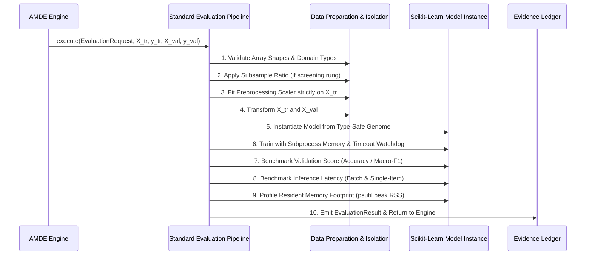

# AMDE 4.0 — Standardized Evaluation & Verification Architecture

**Status:** RATIFIED  
**Module:** [`amde.evaluation`](file:///mnt/c/Users/Admin/Downloads/AMDE_Worktree_v400/src/amde/evaluation/)  
**Files:** [`pipeline.py`](file:///mnt/c/Users/Admin/Downloads/AMDE_Worktree_v400/src/amde/evaluation/pipeline.py), [`sealed.py`](file:///mnt/c/Users/Admin/Downloads/AMDE_Worktree_v400/src/amde/evaluation/sealed.py)

---

## 1. Objectives & Guarantees

The AMDE 4.0 Standardized Evaluation Architecture ensures that every proposed machine-learning candidate pipeline is trained, scored, and profiled under rigorous, non-leaking, and reproducible experimental conditions.

The subsystem guarantees:
1. **Zero Data Leakage:** Preprocessing transformations (imputation, scaling, one-hot encoding) are strictly learned on `X_train` and applied to `X_val` / `X_test` via transform-only interfaces.
2. **Deterministic Partitioning:** Stratified train/val/test splits are derived from a cryptographic split hash and fixed seed.
3. **Cryptographically Sealed Holdout Validation ([BOT-05](file:///mnt/c/Users/Admin/Downloads/AMDE_Worktree_v400/docs/architecture/AMDE_4.0_Architecture_Decision_Records.md)):** The test set is isolated behind a single-use token; any secondary access or unauthorized query triggers an immutable `AccessDeniedViolation`.
4. **Multi-Metric Profiling:** In addition to primary validation accuracy/F1, every trial measures inference latency (in milliseconds) and peak resident memory consumption (in megabytes).

---

## 2. 10-Phase Evaluation Lifecycle

When an `EvaluationRequest` is submitted, the `StandardEvaluationPipeline` executes the following ten distinct phases:



### Detailed Phase Definitions:
1. **Input Validation:** Verifies array dimensions, non-emptiness, NaN absence, and matching target length.
2. **Fidelity Subsampling:** If running under a screening fidelity level ($r < 1.0$), samples a deterministic fraction of training points without replacement using the trial seed.
3. **Preprocessing Fitting:** If the model family requires scaling (`mlp`, `linear`, `kernel_ridge`), a `StandardScaler` is fitted exclusively on the training subset:
   $$\mu_{\text{train}} = \frac{1}{N_{\text{tr}}} \sum_{i=1}^{N_{\text{tr}}} x_i, \quad \sigma^2_{\text{train}} = \frac{1}{N_{\text{tr}}} \sum_{i=1}^{N_{\text{tr}}} (x_i - \mu_{\text{train}})^2$$
4. **Data Transformation:** Applies $\mu_{\text{train}}$ and $\sigma_{\text{train}}$ to $X_{\text{train}}$ and $X_{\text{val}}$:
   $$X_{\text{scaled}} = \frac{X - \mu_{\text{train}}}{\sigma_{\text{train}} + \epsilon}$$
5. **Model Instantiation:** Maps candidate genome hyperparameters into typed scikit-learn estimators (`LogisticRegression`, `MLPClassifier`, `SVC`, `RandomForestClassifier`, `GradientBoostingClassifier`).
6. **Bounded Model Training:** Executes `.fit(X_tr, y_tr)` under wallclock deadline enforcement. Catches convergence warnings and divergence errors cleanly.
7. **Predictive Scoring:** Computes accuracy or balanced Macro-F1 on $X_{\text{val}}$.
8. **Inference Latency Measurement:** Runs 5 warmup iterations followed by 20 timed inference passes on $X_{\text{val}}$. Computes mean per-sample latency:
   $$\tau_{\text{infer}} = \frac{t_{\text{total}}}{20 \cdot N_{\text{val}}} \times 1000 \quad \text{(ms)}$$
9. **Memory Profiling:** Queries `psutil.Process().memory_info().rss` before and after execution to measure incremental memory usage (MB).
10. **Result Packaging:** Returns an immutable `EvaluationResult` containing status (`completed`, `failed`, `timeout`, `pruned`), primary score, latency, and memory.

---

## 3. Cryptographic Sealed Holdout Test (`SealedHoldoutTest`)

To eliminate the common research vulnerability where AutoML engines overfit the validation set through thousands of iterative queries, AMDE 4.0 implements a token-locked sealed test:

```python
class SealedHoldoutTest:
    def __init__(self, dataset_name: str, X_test: np.ndarray, y_test: np.ndarray):
        self.dataset_name = dataset_name
        self._X_test = np.copy(X_test)
        self._y_test = np.copy(y_test)
        self._token = secrets.token_hex(32)
        self._evaluated = False
        self._final_score: Optional[float] = None

    @property
    def token(self) -> str:
        return self._token

    def evaluate(self, candidate: Candidate, X_train: np.ndarray, y_train: np.ndarray, token: str, seed: int) -> float:
        if token != self._token:
            raise AccessDeniedViolation("Invalid cryptographic access token.")
        if self._evaluated:
            raise AccessDeniedViolation("Sealed holdout has already been accessed.")
        self._evaluated = True
        ...
```

- **Single-Use Enforcement:** `_evaluated` flag ensures the test partition can only be evaluated once per discovery campaign.
- **Winning Candidate Only:** The engine evaluates the holdout exclusively on the final winning incumbent candidate after the search budget is exhausted.
