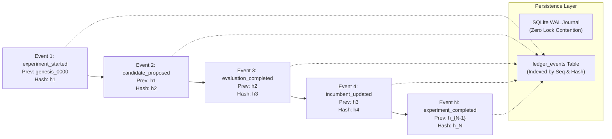

# AMDE 4.0 — Evidence Provenance & Ledger Architecture

**Status:** RATIFIED & FORENSICALLY AUDITABLE  
**Module:** [`amde.ledger`](file:///mnt/c/Users/Admin/Downloads/AMDE_Worktree_v400/src/amde/ledger/)  
**Files:** [`event_ledger.py`](file:///mnt/c/Users/Admin/Downloads/AMDE_Worktree_v400/src/amde/ledger/event_ledger.py)

---

## 1. Problem Formulation & Historical Defects ([DEF-06](file:///mnt/c/Users/Admin/Downloads/AMDE_Worktree_v400/docs/architecture/AMDE_4.0_Architecture_Decision_Records.md))

In AMDE 2.0 and 3.0-Lite, experimental telemetry was split across disparate flat JSON files, ad-hoc CSV logs, and memory dumps. This caused three major reliability and scientific integrity failures:
1. **Truncation and Corruption on Crash:** Unbuffered writes to large JSON files frequently resulted in corrupt syntax when processes were abruptly stopped.
2. **Lack of Cryptographic Lineage:** Telemetry lacked verifiable hash linkages, making it impossible to detect accidental log alterations, duplicate event insertions, or omitted failures.
3. **Write Contention:** Concurrent multi-worker logging caused file-lock contention and missing rows.

---

## 2. AMDE 4.0 Append-Only Ledger Design

AMDE 4.0 introduces a unified, high-performance evidence storage subsystem combining SQLite Write-Ahead Logging (WAL) with cryptographic SHA-256 event chaining.

### 2.1. Cryptographic Hash Chaining Mathematics
Each event record $E_i = (\text{event\_id}_i, \text{type}_i, \text{payload}_i, \text{seq}_i, t_i)$ is bound to its predecessor via:

$$h_i = \text{SHA256}\Big(h_{i-1} \mathbin{\Vert} \text{event\_id}_i \mathbin{\Vert} \text{type}_i \mathbin{\Vert} \text{canonical\_json}(\text{payload}_i) \mathbin{\Vert} \text{seq}_i \mathbin{\Vert} t_i\Big)$$

where $h_0 = \text{"0"}^{64}$ is the immutable genesis hash.

### 2.2. Ledger Invariants and Tamper-Resistance
- **Strict Monotonicity:** Sequence numbers $\text{seq}_i$ increment monotonically from $1$ to $N$.
- **Idempotency:** Unique constraints on `event_id` prevent duplicate event insertion during network retry or process restart.
- **Forensic Verification Method:** The ledger provides `verify_integrity()`, which iterates over the entire chain from genesis to head, recalculating hashes. Any modified payload, deleted row, or out-of-order insertion raises an immediate `LedgerError`.

---

## 3. High-Throughput SQLite WAL Configuration

To guarantee sub-millisecond logging latency without risking OS crash data loss, the ledger applies the following SQLite database pragmas:
- `PRAGMA journal_mode = WAL;` (Write-Ahead Logging enables concurrent reader threads without blocking writes).
- `PRAGMA synchronous = NORMAL;` (Ensures that transactions are safely flushed to WAL before returning, balancing speed and durability).
- `PRAGMA cache_size = -64000;` (64 MB page cache in memory).
- `PRAGMA temp_store = MEMORY;` (Fast temporary index operations).
