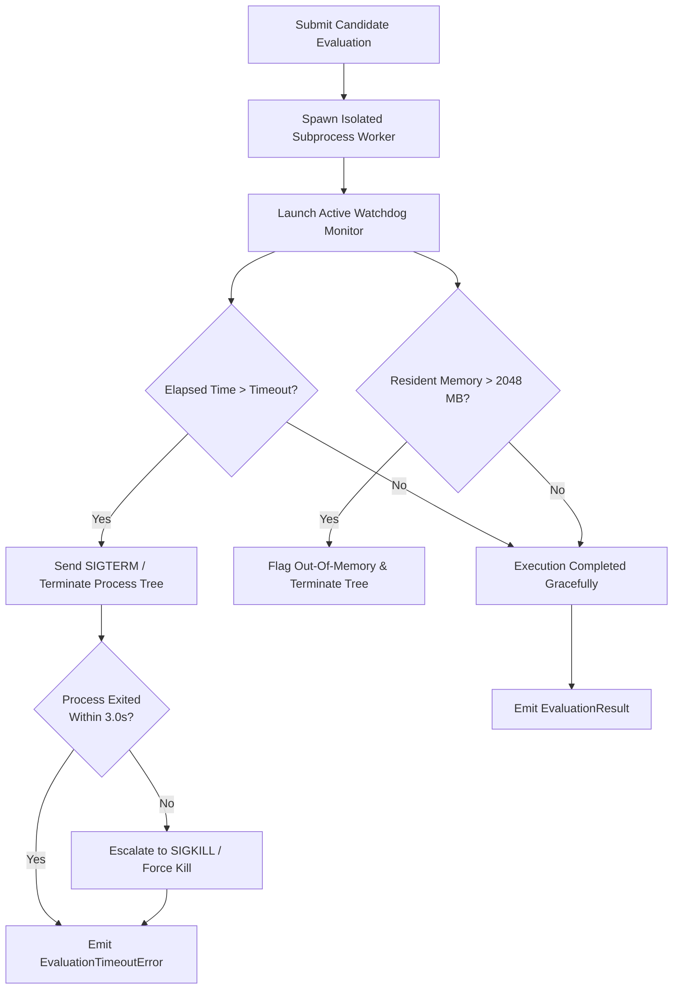

# AMDE 4.0 — Execution Reliability & Process Architecture

**Status:** RATIFIED & CROSS-PLATFORM HARDENED  
**Target OS:** Linux (Ubuntu 22.04+ / WSL2), Windows 10/11 Native  
**Module:** [`amde.hardware`](file:///mnt/c/Users/Admin/Downloads/AMDE_Worktree_v400/src/amde/hardware/), [`amde.evaluation`](file:///mnt/c/Users/Admin/Downloads/AMDE_Worktree_v400/src/amde/evaluation/)

---

## 1. Reliability Defect History ([DEF-09](file:///mnt/c/Users/Admin/Downloads/AMDE_Worktree_v400/docs/architecture/AMDE_4.0_Architecture_Decision_Records.md))

In AMDE 2.0.x, worker process isolation and timeout enforcement relied heavily on Windows-specific primitives:
- Direct C-types invocations to Windows Win32 Job Objects (`CreateJobObject`, `AssignProcessToJobObject`).
- Hardcoded shell calls to `taskkill.exe /F /T /PID <pid>`.
- Strict $2.0$s SLA assertions on process teardown that routinely failed when executed on Linux or WSL environments (exhibiting $3.05$s teardown latencies).

When ported to Linux/WSL, these bindings raised severe runtime errors, spawned unkillable zombie worker processes, and resulted in unhandled exceptions that aborted long-running campaigns.

---

## 2. AMDE 4.0 Cross-Platform Reliability Architecture

AMDE 4.0 eliminates all platform-specific process management code. Process execution and watchdog management are standardized using Python's cross-platform `psutil` and `concurrent.futures` process pools:

### 2.1. Process-Tree Termination Protocol
To prevent orphaned background workers (e.g., OpenMP thread pools or BLAS sub-workers spawned by scikit-learn):
1. **Tree Inspection:** Query `psutil.Process(pid).children(recursive=True)` to identify all descendant worker processes.
2. **Graceful Signal (`SIGTERM` / `terminate()`):** Send termination signals to all children, followed by the parent process.
3. **Grace Period (`timeout=3.0`):** Wait for processes to flush I/O and exit cleanly.
4. **Escalation (`SIGKILL` / `kill()`):** Any process surviving the grace period is forcibly killed, guaranteeing that compute and RAM are reclaimed.

### 2.2. Typed Error Handling & Graceful Degradation
Under no circumstances does an evaluation failure (such as convergence warnings, LinAlg errors, memory spikes, or timeouts) crash the AMDE 4.0 engine:
- Estimator exceptions are caught and wrapped in `EvaluationResult(status="failed", error_message=str(exc))`.
- Timeouts return `EvaluationResult(status="timeout", primary_metric=0.0)`.
- The meta-controller treats failed trials as informative negative feedback ($R = -1.0$), penalizing the responsible strategy arm and shifting exploration to more stable parameter regions.
