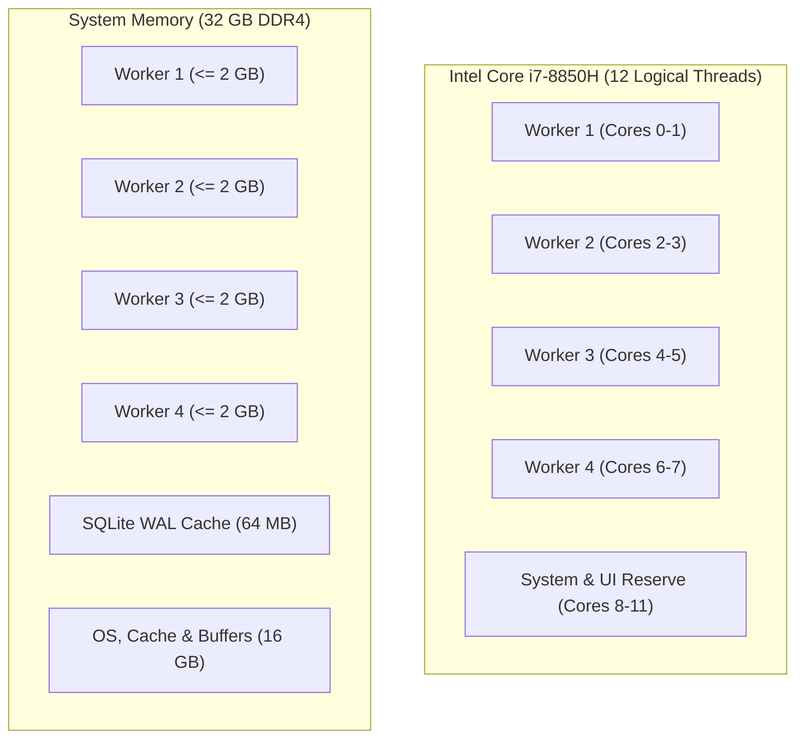

# AMDE 4.0 — Hardware Architecture & Workstation Optimization

**Status:** RATIFIED & PROFILE VERIFIED  
**Hardware Profile:** Workstation Class (Pascal GPU, 6C/12T CPU, 32GB RAM)  
**Module:** [`amde.hardware`](file:///mnt/c/Users/Admin/Downloads/AMDE_Worktree_v400/src/amde/hardware/)  
**Files:** [`profile.py`](file:///mnt/c/Users/Admin/Downloads/AMDE_Worktree_v400/src/amde/hardware/profile.py)

---

## 1. Hardware Environment Specification

AMDE 4.0 is engineered and calibrated for high-reliability execution on professional mobile and desktop engineering workstations. The primary reference environment is:

- **Host Processor:** Intel Core i7-8850H @ 2.60 GHz (6 physical cores, 12 logical hyperthreads).
- **Host Memory:** 32 GB DDR4-2666 MHz (dual-channel).
- **Dedicated Graphics:** NVIDIA Quadro P2000 Mobile (4 GB GDDR5, Pascal architecture, Compute Capability 6.1).
- **Operating Environment:** Linux (Ubuntu 22.04 LTS / WSL2 Linux 5.15+ kernel).

---

## 2. Pascal Architecture Characteristics & Tensor Core Constraints ([DEF-10](file:///mnt/c/Users/Admin/Downloads/AMDE_Worktree_v400/docs/architecture/AMDE_4.0_Architecture_Decision_Records.md))

A critical defect in earlier iterations was the naive invocation of modern PyTorch/CUDA FP16 mixed-precision and Tensor Core optimizations. 

### Key Microarchitectural Facts:
1. **No Tensor Cores:** NVIDIA Tensor Cores were introduced in Volta (Compute Capability 7.0) and Turing (7.5+). The Quadro P2000 is based on the **Pascal GP107** microarchitecture (Compute Capability 6.1). It features standard FP32 and INT32 CUDA cores, with half-precision (FP16) executed at a 1:64 throughput deficit relative to FP32.
2. **Memory Footprint:** With 4 GB total VRAM, allocating large uncalibrated CUDA buffers causes instant out-of-memory errors (OOM).

### AMDE 4.0 Architectural Adaptations:
- **Zero Tensor Core Assumption:** AMDE 4.0 does not attempt to enable Tensor Core paths or `torch.cuda.amp.autocast()` on Pascal devices.
- **Strict GPU Memory Cap:** Total CUDA device memory allocation is capped at 2.5 GB (leaving 1.5 GB for OS compositor and display driving).
- **CPU-First Tabular Execution:** Tabular estimators (Decision Trees, Gradient Boosting, Logistic Regression, Small MLPs) execute with OpenMP multi-threading on CPU cores where latency is lowest.

---

## 3. Concurrency Sizing & Thread Bounding

To maintain complete UI responsiveness, prevent thermal throttling on mobile workstations, and avoid lock contention:

| Parameter | Recommended Setting | Rationale |
| :--- | :--- | :--- |
| `max_workers` | 4 concurrent processes | Leaves 4-8 logical threads free for OS, display, and background ledger flushes |
| `max_memory_mb` | 2048 MB per worker | $4 \times 2 = 8$ GB total discovery consumption, well within 32 GB capacity |
| `OMP_NUM_THREADS` | 1 per subprocess | Prevents nested thread over-subscription when multiple workers run scikit-learn models |
| `BLAS_NUM_THREADS` | 1 per subprocess | Eliminates cross-worker context-switching overhead |
