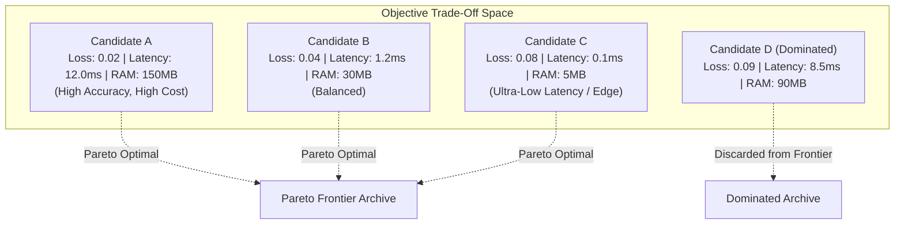

# AMDE 4.0 — Multi-Objective Optimization & Pareto Architecture

**Status:** RATIFIED  
**Module:** [`amde.archive`](file:///mnt/c/Users/Admin/Downloads/AMDE_Worktree_v400/src/amde/archive/)  
**Files:** [`pareto.py`](file:///mnt/c/Users/Admin/Downloads/AMDE_Worktree_v400/src/amde/archive/pareto.py), [`elite.py`](file:///mnt/c/Users/Admin/Downloads/AMDE_Worktree_v400/src/amde/archive/elite.py)

---

## 1. Problem Formulation & Multi-Objective Dimensions

Standard AutoML systems frequently optimize exclusively for validation accuracy, resulting in excessively deep ensembles, bloated memory footprints, and unacceptable inference latencies that render models impractical for real-world or edge deployment.

AMDE 4.0 elevates multi-objective optimization to a first-class architectural concern. Every evaluated candidate is profiled across three competing objectives:

$$\min_{\mathbf{x} \in \Omega} \mathbf{F}(\mathbf{x}) = \begin{bmatrix} f_1(\mathbf{x}) \\ f_2(\mathbf{x}) \\ f_3(\mathbf{x}) \end{bmatrix} = \begin{bmatrix} \text{Validation Loss } (1.0 - \text{Score}) \\ \text{Inference Latency } (\text{milliseconds}) \\ \text{Peak Memory Consumption } (\text{MB}) \end{bmatrix}$$

---

## 2. Pareto Dominance & Non-Dominated Sorting

A candidate solution $\mathbf{a}$ **strictly dominates** candidate solution $\mathbf{b}$ (denoted $\mathbf{a} \prec \mathbf{b}$) if and only if:
$$\forall i \in \{1, 2, 3\}, \quad f_i(\mathbf{a}) \le f_i(\mathbf{b}) \quad \land \quad \exists j \in \{1, 2, 3\} \text{ s.t. } f_j(\mathbf{a}) < f_j(\mathbf{b})$$

The **Pareto Frontier** $\mathcal{P}^*$ is the subset of all evaluated candidates that are non-dominated by any other candidate:
$$\mathcal{P}^* = \Big\{ \mathbf{x} \in \mathcal{E} \;\Big|\; \nexists \mathbf{x}' \in \mathcal{E} \text{ s.t. } \mathbf{x}' \prec \mathbf{x} \Big\}$$

---

## 3. Hypervolume Metric & Mathematical Formulation

To quantify the quality, diversity, and extent of the discovered Pareto frontier, AMDE 4.0 computes the exact Hypervolume Indicator ($HV$). The hypervolume measures the multi-dimensional Lebesgue measure $\Lambda$ of the region dominated by the Pareto frontier bounded by an anti-optimal reference point $\mathbf{r}$:

$$HV(\mathcal{P}^*, \mathbf{r}) = \Lambda\left( \bigcup_{\mathbf{x} \in \mathcal{P}^*} [\mathbf{x}, \mathbf{r}] \right)$$

### 3.1. Standard Reference Coordinates
For standardized tabular benchmarking in AMDE 4.0:
- Reference point $\mathbf{r} = (r_{\text{loss}}, r_{\text{latency}}, r_{\text{memory}}) = (1.0, 50.0 \text{ ms}, 500.0 \text{ MB})$.
- In 2D projections (Loss vs Latency):
  $$HV_{\text{2D}}(\mathcal{P}^*) = \sum_{i=1}^{k} \Big(r_{\text{loss}} - x_i^{(\text{loss})}\Big) \cdot \Big(x_{i+1}^{(\text{lat})} - x_i^{(\text{lat})}\Big)$$

---

## 4. Architectural Implementation (`ParetoArchive`)

The [`ParetoArchive`](file:///mnt/c/Users/Admin/Downloads/AMDE_Worktree_v400/src/amde/archive/pareto.py) provides:
1. **Bounded Capacity:** Retains up to $M=64$ non-dominated candidates. When capacity is reached, secondary crowding-distance pruning preserves boundary and diverse solutions.
2. **Fast Incremental Dominance Check:** When a new evaluation result arrives, it is tested against current frontier members in $O(|\mathcal{P}^*|)$ time. Any existing members dominated by the new candidate are pruned immediately.
3. **Multi-Model Deployment Options:** Rather than returning a single opaque winner, AMDE 4.0 provides users with:
   - **Peak Accuracy Specialist:** Lowest loss on validation.
   - **Edge Deployment Specialist:** Sub-millisecond latency with minimal memory.
   - **Balanced Production Champion:** Maximum hypervolume contribution.
