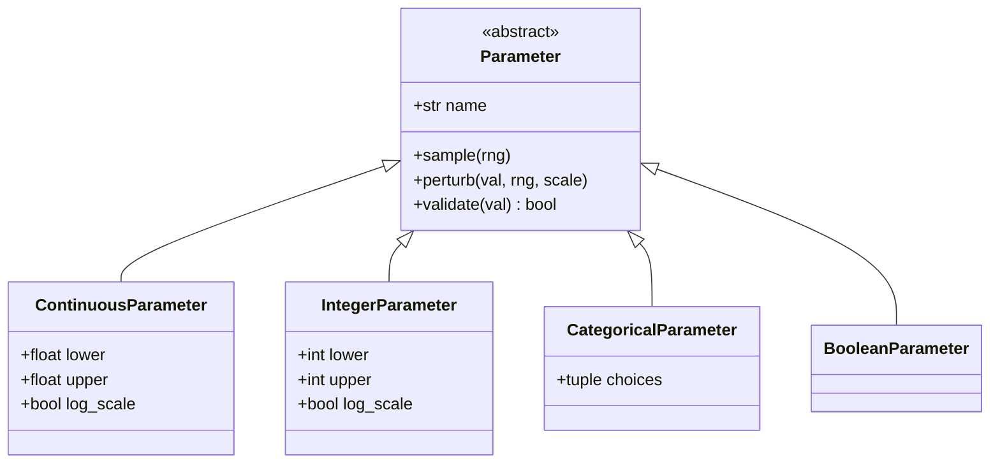
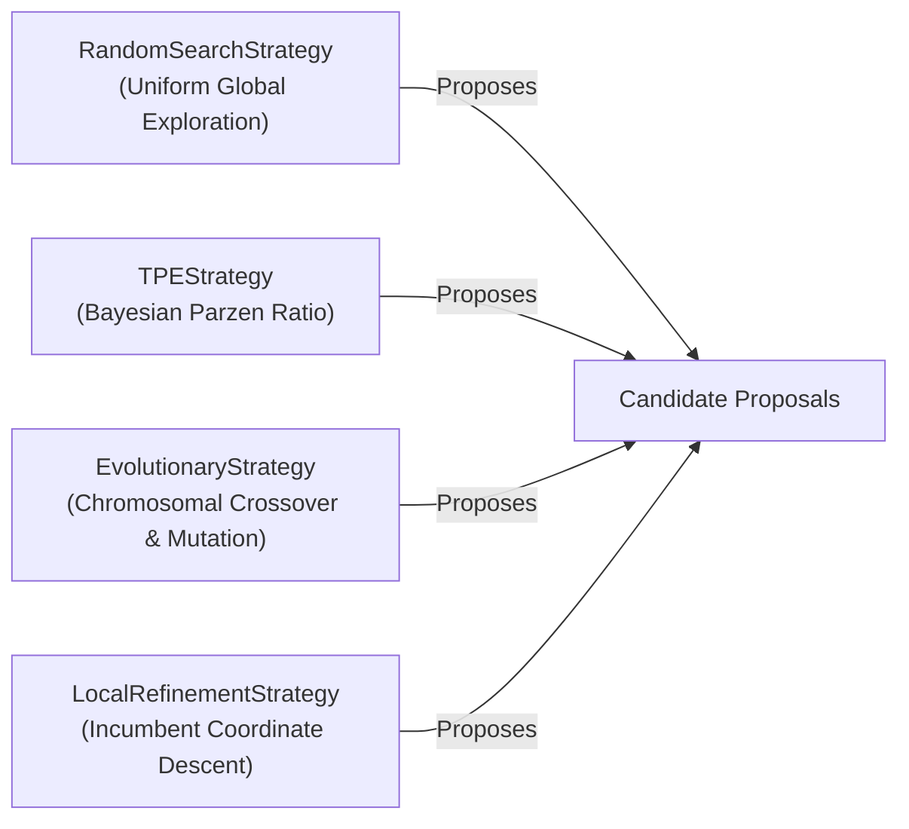

# AMDE 4.0 — Search Engine & Candidate Generation Design

**Status:** RATIFIED  
**Module:** [`amde.space`](file:///mnt/c/Users/Admin/Downloads/AMDE_Worktree_v400/src/amde/space/), [`amde.strategy`](file:///mnt/c/Users/Admin/Downloads/AMDE_Worktree_v400/src/amde/strategy/)  
**Files:** [`parameter.py`](file:///mnt/c/Users/Admin/Downloads/AMDE_Worktree_v400/src/amde/space/parameter.py), [`search_space.py`](file:///mnt/c/Users/Admin/Downloads/AMDE_Worktree_v400/src/amde/space/search_space.py), [`portfolio.py`](file:///mnt/c/Users/Admin/Downloads/AMDE_Worktree_v400/src/amde/strategy/portfolio.py)

---

## 1. Overview and Design Objectives

Candidate generation in AMDE 4.0 is driven by a type-safe, hierarchical search space and a modular portfolio of search strategies. The design fulfills four core requirements:
1. **Structural Validity by Construction:** Only syntactically valid model families and hyperparameter combinations can be sampled, mutated, or crossed over.
2. **Strategy Orthogonality:** Each search strategy declares its computational overhead and required state information (e.g., access to elite archive), allowing dynamic portfolio composition.
3. **Genetic Integrity:** Perturbation operators respect parameter type boundaries, log-scale distributions, and discrete categorical domains.
4. **$O(1)$ Novelty Filtering:** Candidates are vetted by a cryptographic deduplicator before submission to the evaluation pipeline.

---

## 2. Parameter Representations & Perturbations

All parameter specifications inherit from `Parameter`:

### 2.1. Perturbation Mathematics
- **Continuous Parameters ($x \in [a, b]$):**
  If `log_scale` is true, perturbation is performed in logarithmic space:
  $$\tilde{z} \sim \mathcal{N}\left(\log_{10} x, \sigma \cdot (\log_{10} b - \log_{10} a)\right)$$
  $$\tilde{x} = \text{clip}\left(10^{\tilde{z}}, a, b\right)$$
  If linear, Gaussian perturbation is applied directly:
  $$\tilde{x} = \text{clip}\left(x + \mathcal{N}(0, \sigma \cdot (b - a)), a, b\right)$$
- **Integer Parameters ($k \in [a, b]$):**
  $$\tilde{k} = \text{clip}\left(\text{round}\left(k + \mathcal{N}(0, \max(1.0, \sigma \cdot (b - a)))\right), a, b\right)$$
- **Categorical Parameters ($c \in \{c_1, \dots, c_m\}$):**
  With probability $1 - \sigma$, $c$ is retained; with probability $\sigma$, a different choice is sampled uniformly from $\{c_j \mid c_j \neq c\}$.

---

## 3. Supported Model Families

The search space spans four distinct model families tailored for tabular classification:

| Family | Key Hyperparameters | Search Domain | Default Scaling |
| :--- | :--- | :--- | :--- |
| **`tree_ensemble`** | `n_estimators` `max_depth` `min_samples_split` `learning_rate` | $[10, 150]$ (Int) $[2, 12]$ (Int) $[2, 16]$ (Int) $[0.01, 0.5]$ (Cont, Log) | None (Tree-based) |
| **`mlp`** | `hidden_layer_sizes` `activation` `alpha` `learning_rate_init` | `(32,)` to `(64, 32)` (Cat) `relu`, `tanh` (Cat) $[10^{-5}, 10^{-1}]$ (Cont, Log) $[10^{-4}, 10^{-1}]$ (Cont, Log) | StandardScaler |
| **`linear`** | `C` `penalty` `l1_ratio` | $[10^{-3}, 10^{3}]$ (Cont, Log) `l2`, `none` (Cat) $[0.0, 1.0]$ (Cont) | StandardScaler |
| **`kernel_ridge`** | `C` `kernel` `gamma` | $[10^{-2}, 10^{2}]$ (Cont, Log) `rbf`, `linear`, `poly` (Cat) $[10^{-3}, 10.0]$ (Cont, Log) | StandardScaler |

---

## 4. Search Strategy Portfolio

The standard AMDE 4.0 portfolio combines four complementary search strategies:

### 4.1. `RandomSearchStrategy`
- Generates unbiased candidate genomes across all available families and parameter domains.
- Serves as the exploration anchor and provides the theoretical lower bound on optimization performance.
- Overhead: $< 0.1$ ms per proposal.

### 4.2. `TPEStrategy` (Tree-structured Parzen Estimator)
- Partitions observed evaluations into two groups based on quantile $\gamma = 0.25$:
  - $l(x)$: Density of top-performing candidates.
  - $g(x)$: Density of lower-performing candidates.
- Evaluates candidate proposals to maximize the density ratio:
  $$\text{EI}(x) \propto \frac{l(x)}{g(x)}$$
- Overhead: $\approx 1.8$ ms per proposal.

### 4.3. `EvolutionaryStrategy`
- Samples parent candidates from the `EliteArchive`.
- Applies chromosomal crossover between two distinct parents with probability $P_{\text{cross}} = 0.35$.
- Applies targeted Gaussian/categorical mutation to hyperparameters with perturbation scale $\sigma = 0.20$.
- Overhead: $\approx 0.35$ ms per proposal.

### 4.4. `LocalRefinementStrategy`
- Performs stochastic coordinate descent on the active `Incumbent` candidate.
- Selects a single continuous or integer hyperparameter at a time and applies a fine-scale perturbation ($\sigma = 0.08$).
- Overhead: $\approx 0.15$ ms per proposal.
