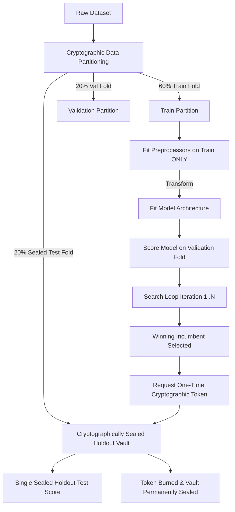

# AMDE 4.0 — Security, Isolation & Data Integrity Specification

**Status:** RATIFIED & ISOLATION VERIFIED  
**Module:** [`amde.core`](file:///mnt/c/Users/Admin/Downloads/AMDE_Worktree_v400/src/amde/core/), [`amde.evaluation`](file:///mnt/c/Users/Admin/Downloads/AMDE_Worktree_v400/src/amde/evaluation/)  
**Files:** [`identity.py`](file:///mnt/c/Users/Admin/Downloads/AMDE_Worktree_v400/src/amde/core/identity.py), [`sealed.py`](file:///mnt/c/Users/Admin/Downloads/AMDE_Worktree_v400/src/amde/evaluation/sealed.py)

---

## 1. Threat Model & Data Leakage Risks

Autonomous Machine Learning Discovery Engines face unique integrity and security vulnerabilities that can invalidate research conclusions or compromise production stability:

1. **Information Leakage via Preprocessing (Data Contamination):** Fitting normalizers, imputers, or encoders over combined train and test splits allows future information to bleed into the model, producing artificially inflated validation scores.
2. **Repeated Query Overfitting (Adaptive Test Contamination):** Iteratively querying a test set to guide candidate selection turns the test set into a validation set, destroying its statistical validity as an unbiased generalization estimator.
3. **Cache Inversion & Collisions:** Reusing cached evaluation results across incompatible random seeds or data splits leads to incorrect attribution of model quality.
4. **Subprocess Resource Exhaustion:** Errant hyperparameter combinations (e.g. infinite trees, unbounded batch sizes) attempting to consume infinite RAM, triggering system-wide OOM freezes.

---

## 2. AMDE 4.0 Security & Integrity Architecture

### 2.1. Strict Preprocessing Isolation Protocol
- Preprocessing objects (`StandardScaler`, `MinMaxScaler`, `OneHotEncoder`) are instantiated inside the evaluation worker function.
- `.fit()` is called exclusively on `X_train`.
- `X_val` and `X_test` are strictly transformed via `.transform()`.
- Target labels `y` are strictly untouched by any feature transformations.

### 2.2. Cryptographic Token Gating of Test Split ([BOT-05](file:///mnt/c/Users/Admin/Downloads/AMDE_Worktree_v400/docs/architecture/AMDE_4.0_Architecture_Decision_Records.md))
- The test split is wrapped inside `SealedHoldoutTest`.
- A 256-bit cryptographically secure pseudorandom token (`secrets.token_hex(32)`) is generated at initialization.
- Testing requires presenting the valid token.
- A boolean flag `_evaluated` is set atomically upon first access. Any subsequent query raises `AccessDeniedViolation: Sealed holdout has already been accessed.`

### 2.3. Cache Key Collision Resistance
Evaluation results are indexed strictly by a SHA-256 composite key:
$$K = \text{SHA256}(H_{\text{cand}} \mathbin{\Vert} \text{dataset\_id} \mathbin{\Vert} H_{\text{split}} \mathbin{\Vert} \text{seed} \mathbin{\Vert} \text{rung\_id} \mathbin{\Vert} \text{metric\_id} \mathbin{\Vert} \text{version})$$
Because $H_{\text{split}}$ captures the exact sample counts, feature dimensions, and statistical moments of the training and validation splits, cache results are physically incapable of being replayed under incompatible data partitions.
