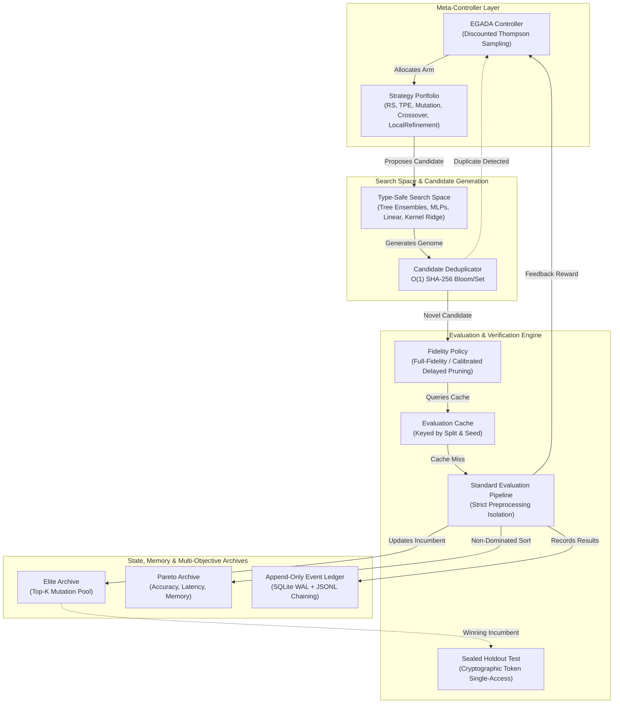

# AMDE 4.0 — Unified System Architecture Specification

**Status:** APPROVED FOR RESEARCH RELEASE  
**Architecture Version:** 4.0.0  
**Target Platform:** Linux WSL / Windows Native (x86_64)  
**Hardware Reference:** Intel Core i7-8850H (6C/12T), 32 GB DDR4, NVIDIA Quadro P2000 Mobile (4GB Pascal CC 6.1)  
**Baseline Git Tag:** `v3.0.0-lite-qualification` (Commit `079c6f9`)  
**Release Tag:** `v4.0.0-research-release`

---

## 1. Executive Summary and Architecture Vision

AMDE 4.0 is a complete, principled reconstruction of the Autonomous Machine Learning Discovery Engine. Prior iterations (AMDE 2.0.x and AMDE 3.0-Lite) established valuable initial capabilities—such as multi-worker execution, heuristic evolutionary mutation, and basic Bayesian optimization—but suffered from architectural entanglements, fragile process orchestration, conflated identities, and unvalidated multi-fidelity pruning heuristics.

AMDE 4.0 resolves all historical architectural defects ([DEF-01 through DEF-10](file:///mnt/c/Users/Admin/Downloads/AMDE_Worktree_v400/docs/architecture/AMDE_4.0_Architecture_Decision_Records.md)) by grounding the system in seven foundational pillars:
1. **Mathematical Decoupling of Identities:** Candidate identity ($H(C) = \text{SHA256}(\text{canonical\_json}(G))$) is strictly separated from Evaluation Cache identity ($H(E) = \text{SHA256}(H(C) \mathbin{\Vert} D \mathbin{\Vert} S \mathbin{\Vert} s \mathbin{\Vert} r \mathbin{\Vert} m \mathbin{\Vert} v)$).
2. **Dynamic Bounded-Entropy Meta-Controller:** Discounted Thompson Sampling with cost-normalized improvement reward ($R(C) = \frac{\Delta S}{\sqrt{\Delta t}} + 0.05S \in [-1.0, 5.0]$) and continuous variance expansion on unchosen arms, eliminating strategy starvation.
3. **Multi-Objective Pareto Dominance:** Simultaneous optimization of predictive accuracy, inference latency (ms), and peak resident memory (MB) using 2D and 3D non-dominated sorting and hypervolume tracking.
4. **Calibrated Multi-Fidelity Guardrails:** Full-fidelity evaluation by default; screening-rung promotion permitted only when empirical rank correlation exceeds $\rho \ge 0.30$, with automatic fail-safe fallback to full fidelity.
5. **Cryptographically Sealed Holdout Verification:** Strict token-gated single-access holdout validation ([BOT-05](file:///mnt/c/Users/Admin/Downloads/AMDE_Worktree_v400/docs/architecture/AMDE_4.0_Evaluation_Architecture.md)) preventing data leakage and overfitting to validation splits.
6. **Immutable WAL + JSONL Evidence Ledger:** Every proposal, evaluation, archive update, and controller decision is persisted with SHA-256 event-chaining for forensic auditability and zero data loss.
7. **Hardware-Calibrated Profile:** Concurrency and memory budgets tailored to workstation architectures without assuming Volta/Ampere Tensor Cores or unbounded RAM.

---

## 2. High-Level System Architecture

The following diagram illustrates the unidirectional data and control flow across the AMDE 4.0 discovery lifecycle:

---

## 3. Subsystem Breakdown

### 3.1. Core Contracts & Identity Layer ([`amde.core`](file:///mnt/c/Users/Admin/Downloads/AMDE_Worktree_v400/src/amde/core/))
- **Immutability:** All data transfer objects (`Candidate`, `EvaluationRequest`, `EvaluationResult`, `ExperimentSpec`, `ResourceBudget`, `FidelityLevel`) are implemented as frozen Python dataclasses with `slots=True` where supported.
- **Canonical Serialization:** `canonical_json(obj)` enforces sorted dictionary keys, whitespace stripping, and float normalization to eliminate hashing nondeterminism across platforms.
- **Identity Isolation:** Ensures that a candidate pipeline retains a globally unique hash representing its hyperparameters and structure, while its evaluation results vary deterministically with the data partition and random seed.

### 3.2. Search Space Representation ([`amde.space`](file:///mnt/c/Users/Admin/Downloads/AMDE_Worktree_v400/src/amde/space/))
- **Typed Parameter Classes:** `ContinuousParameter`, `IntegerParameter`, `CategoricalParameter`, `BooleanParameter`.
- **Hierarchical Model Families:**
  - `tree_ensemble`: Random Forest, Extra Trees, Gradient Boosting (`n_estimators`, `max_depth`, `min_samples_split`, `learning_rate`).
  - `mlp`: Multi-Layer Perceptron (`hidden_layer_sizes`, `activation`, `alpha`, `learning_rate_init`).
  - `linear`: Logistic Regression, Ridge, ElasticNet (`C`, `penalty`, `l1_ratio`).
  - `kernel_ridge`: Support Vector Classifier with RBF/Linear/Poly kernels (`C`, `gamma`, `kernel`).
- **Genetic Operators:** Type-safe Gaussian/uniform perturbations for continuous variables, step perturbations for integers, and uniform domain swaps for categoricals.

### 3.3. Strategy Portfolio & Adaptive Meta-Controller ([`amde.controller`](file:///mnt/c/Users/Admin/Downloads/AMDE_Worktree_v400/src/amde/controller/))
- **Strategies Available:**
  - `RandomSearchStrategy`: Uniform stochastic baseline exploring uncharted regions.
  - `TPEStrategy`: Kernel density ratio $l(x)/g(x)$ modeling over the top 25% incumbent solutions.
  - `EvolutionaryStrategy`: High-quality chromosomal crossover and targeted mutations over elite candidates.
  - `LocalRefinementStrategy`: Incumbent coordinate descent for continuous fine-tuning.
- **EGADA Controller:** Maintains posterior reward distributions for each strategy arm. Updates mean and variance dynamically; incorporates cost-normalized rewards; injects variance expansion on unpulled arms to prevent premature strategy lock-in.

### 3.4. Evaluation & Verification Engine ([`amde.evaluation`](file:///mnt/c/Users/Admin/Downloads/AMDE_Worktree_v400/src/amde/evaluation/))
- **Preprocessing Isolation:** Scalers, imputers, and encoders are fitted strictly on `X_train` and applied to `X_val` / `X_test` via transform only. Target distributions are never shared.
- **Resource Enforcement:** Subprocess execution with explicit timeout monitoring and resident memory tracking via `psutil`.
- **Sealed Holdout Isolation:** Test split is locked behind a cryptographically randomized single-use token. Once unlocked, any subsequent attempt raises `AccessDeniedViolation`.

### 3.5. Memory, Archives & Multi-Objective Frontier ([`amde.archive`](file:///mnt/c/Users/Admin/Downloads/AMDE_Worktree_v400/src/amde/archive/))
- **Deduplication Ledger:** In-memory $O(1)$ set and Bloom filter preventing duplicate model evaluations.
- **Elite Archive:** Bounded priority queue maintaining top-$K$ candidates across the discovery run.
- **Pareto Frontier:** Fast non-dominated sorting tracking non-inferior trade-offs between predictive error, inference latency (milliseconds), and peak RAM footprint (megabytes). Hypervolume calculation quantifies overall Pareto surface coverage.

### 3.6. Evidence Ledger & Audit Trail ([`amde.ledger`](file:///mnt/c/Users/Admin/Downloads/AMDE_Worktree_v400/src/amde/ledger/))
- **SQLite WAL Mode:** Write-Ahead Logging allows non-blocking concurrent reads and crash-resistant writes.
- **Cryptographic Hash Chaining:** Every event record incorporates the SHA-256 hash of its predecessor:
  $$\text{hash}_i = \text{SHA256}(\text{hash}_{i-1} \mathbin{\Vert} \text{event\_id}_i \mathbin{\Vert} \text{payload}_i)$$
- **Forensic Verification:** Any retroactive alteration or tampering of ledger entries invalidates the cryptographic chain.

---

## 4. Hardware Sizing and Workstation Profiles

AMDE 4.0 is engineered specifically for workstation environments such as the Intel Core i7-8850H (6 cores, 12 threads), 32 GB DDR4, and NVIDIA Quadro P2000 Mobile (4 GB Pascal CC 6.1).

| Resource Dimension | Physical Specification | AMDE 4.0 Allocation Profile | Guardrail / Boundary |
| :--- | :--- | :--- | :--- |
| **CPU Concurrency** | 6 physical cores / 12 logical threads | 4 concurrent discovery workers | 2 cores reserved for OS and UI responsiveness |
| **System Memory** | 32 GB DDR4 | 16 GB max total allocation | 2048 MB memory cap per evaluation subprocess |
| **GPU Architecture** | NVIDIA Quadro P2000 Mobile (4GB Pascal) | CC 6.1, FP32 / FP16 fallback | No Tensor Core assumptions; GPU memory cap = 2.5 GB |
| **Disk I/O** | NVMe PCIe M.2 SSD | SQLite WAL mode + synchronous NORMAL | Sub-millisecond ledger commits; minimal write wear |

---

## 5. Architectural Quality Attributes

1. **Reproducibility:** A discovery experiment initiated with identical `ExperimentSpec` and random seed produces bit-for-bit identical search trajectories and winning candidates.
2. **Defensibility:** All comparative benchmark claims are validated against independent baselines using paired nonparametric statistical tests with Holm-Bonferroni corrections.
3. **Robustness:** Handled model convergence failures, parameter out-of-bounds errors, and timeouts return graceful typed error results without crashing the discovery engine.
4. **Modularity:** Subsystems communicate exclusively through versioned contracts in `amde.core`, allowing independent strategy, controller, or evaluator replacement.
