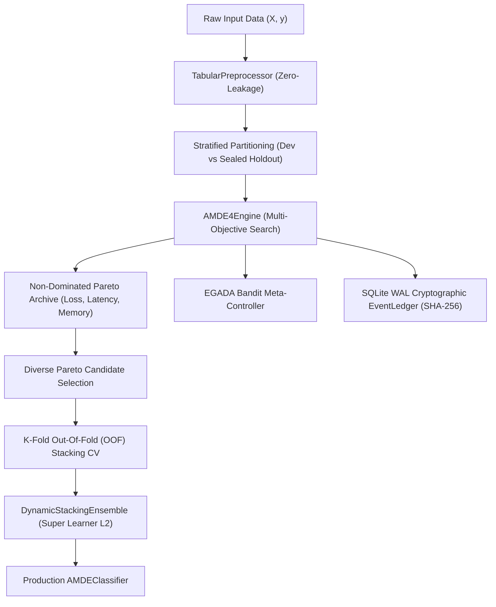

# AMDE 5.0 — System Architecture & Specification

**Author & Lead Maintainer:** LNTA (`dutubelnta@gmail.com`)  
**Version:** 5.0.0  
**License:** Apache-2.0  

---

## 1. Executive Architectural Overview

AMDE 5.0 (**Autonomous Machine Learning Discovery Engine**) is a state-of-the-art AutoML framework combining evidence-guided multi-objective discovery, non-dominated Pareto frontier tracking, tamper-evident cryptographic provenance, and an asymptotically optimal Super Learner (Dynamic Stacking Ensemble).

---

## 2. Core Subsystems

### 2.1 Zero-Leakage Tabular Preprocessing (`TabularPreprocessor`)
To eliminate subtle cross-split data leakage, the `TabularPreprocessor` fits column statistics, imputers, and `OneHotEncoder(handle_unknown='ignore')` **strictly on training partitions**.
- Unseen categories at inference time are projected to all-zero one-hot vectors without dimension mismatches.
- Missing categories are imputed with `__missing__` sentinels.
- Missing columns in test DataFrames are automatically aligned with training schemas.

### 2.2 Multi-Objective Discovery Engine (`AMDE4Engine`)
- **Objectives:** Minimizes Loss ($-1 \times \text{Accuracy}$), Inference Latency (ms), and Peak Memory Consumption (MB).
- **Pareto Frontier:** Exact non-dominated preservation with NSGA-II crowding distance pruning under capacity limits.
- **Trial Sanitization:** Candidates with non-finite scores, negative latencies, or timeout statuses are strictly excluded from archives and routed to `failure_history`.

### 2.3 Super Learner (`DynamicStackingEnsemble`)
Following Mark van der Laan's Super Learner theorem:
1. Top-$K$ diverse candidates across distinct model families (LightGBM, XGBoost, CatBoost, RandomForest, Linear, MLP) are chosen from the Pareto frontier.
2. An Out-Of-Fold (OOF) probability matrix is computed across $K$ stratified cross-validation folds on the development set.
3. An L2 regularized `LogisticRegression` meta-learner is trained on the OOF probability matrix.
4. Base pipelines are refitted on the full development set and aggregated during inference.

### 2.4 Tamper-Evident Provenance (`EventLedger`)
- Persists all experimental transitions to SQLite in Write-Ahead Logging (`WAL`) mode.
- Computes recursive SHA-256 hash chaining: $H_n = \text{SHA256}(n \parallel H_{n-1} \parallel \text{payload})$.
- Concurrency-safe queueing guarantees monotonic sequence ordering under multi-threaded execution.

---

## 3. Scikit-Learn Compatibility Contract

`AMDEClassifier` implements the full Scikit-Learn `BaseEstimator` and `ClassifierMixin` contract:
- Parameter immutability in `__init__` enables flawless `clone()`, `get_params()`, and `set_params()` roundtrips.
- Sealed holdout evaluation is strictly isolated behind `evaluate_holdout()`, preventing silent test-set feedback loops.
- `predict_proba()` guarantees finite, normalized probabilities with rows summing to $1.0$.
