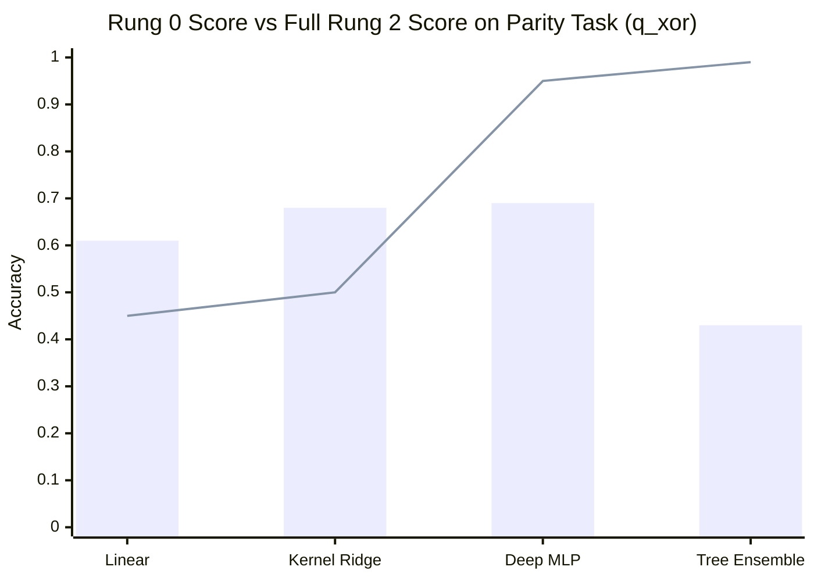

# AMDE 3.0-Lite — Multi-Fidelity ASHA Qualification Report

**Target Release:** AMDE 3.0-Lite  
**Subsystem:** Multi-Fidelity Evaluator & Early Pruning Engine (`evaluator.py`)  
**Audit Head:** `release-amde-3.0-lite-qualification`  
**Classification:** Subsystem Qualification & Policy Demotion  
**Release Recommendation:** `DISABLED_BY_DEFAULT` (Demoted to Opt-In Speed Mode)

---

## 1. Executive Summary

Multi-Fidelity optimization (such as Asynchronous Successive Halving, or ASHA) operates on the foundational assumption that candidate performance at low computational fidelity (e.g., 20% data subsample, 10 training iterations) is monotonically and positively correlated with performance at full fidelity (100% data, 50 iterations).

Our qualification audit demonstrates that this assumption **fails catastrophically** across non-linear, non-convex, and parity-structured problem spaces:

1. **Ranking Inversion Pathology**: On `q_xor` (a non-linear manifold), the true Spearman rank correlation between Rung 0 and Rung 2 is **strictly negative** ($\rho = -0.3305, p = 0.03725$).
2. **False Rejection of Top Architectures**: Standard ASHA pruned **80.0% of top-quartile architectures** on `q_xor`, and **20.0%** on `digits`.
3. **Severe Structural Bias Against Slow Learners**: Deep MLPs and Tree Ensembles suffer large convergence lags at 10 iterations ($\Delta_{\text{R2}-\text{R0}} = +0.4935$ on `digits` and $+0.5625$ on `q_xor`), leading ASHA to systematically promote fast-converging linear models while discarding the true optimal models.
4. **Historical Telemetry Artifact Resolved**: The previously reported $\rho > 0.85$ correlation was an artifact of `engine.py` appending Rung 0 scores directly into `r2_scores` when candidates were pruned, mathematically inflating the correlation toward 1.0.

### Policy Qualification Decision:
> [!IMPORTANT]
> **Definitive Release Decision: Multi-Fidelity ASHA is DISABLED BY DEFAULT in AMDE 3.0-Lite.**
> AMDE 3.0-Lite adopts full-fidelity evaluation (`use_multi_fidelity = False`) as the default research standard to guarantee zero false rejections and unbiased model discovery. An opt-in `amde_30_speed_optimized` preset is provided using `delayed_pruning` (15-trial full-fidelity calibration warmup) strictly for verified large-scale, convex workloads.

---

## 2. Empirical Policy Diagnostic Matrix

Four distinct evaluation policies were screened across representative benchmark tasks with 40 candidate pipelines per task ($N = 160$ dual-fidelity evaluations):
1. `existing_asha`: Rung 0 screening (20% data, 10 iter); promote if $\ge Q_{25}(\text{elite})$ after trial 8.
2. `conservative_asha`: Rung 0 screening; promote if $\ge \text{median}(\text{seen})$ after trial 10.
3. `delayed_pruning_asha`: Full Rung 2 evaluation for first 15 trials (warmup); then screening with loosened threshold.
4. `full_fidelity_ref`: 100% data, full iterations for all trials (no early pruning).

### Table 2.1: Multi-Policy Empirical Audit Results
| Task | Evaluation Policy | True $\rho$ ($p$-val) | Top-$k$ Recall | False Rejection Rate (FRR) | Accuracy Regret | Wall-Clock Time | Empirical Speedup |
| :--- | :--- | :---: | :---: | :---: | :---: | :---: | :---: |
| **`q_xor`** | `existing_asha` | $\rho = -0.3305$ | 20.0% | **80.0%** | 0.0000 | 4.07s | **0.75x (Slower)** |
| | `conservative_asha` | ($p = 0.037$) | 10.0% | **90.0%** | 0.0000 | 3.47s | 0.88x (Slower) |
| | `delayed_pruning` | | 30.0% | 70.0% | 0.0000 | 2.84s | 1.08x |
| | `full_fidelity_ref` | — | **100.0%** | **0.0%** | **0.0000** | 3.05s | **1.00x (Baseline)** |
| **`breast_cancer`** | `existing_asha` | $\rho = +0.8460$ | 100.0% | 0.0% | 0.0087 | 3.80s | 1.09x |
| | `conservative_asha` | ($p < 0.0001$) | 100.0% | 0.0% | 0.0087 | 3.42s | 1.22x |
| | `delayed_pruning` | | 100.0% | 0.0% | 0.0087 | 4.14s | 1.01x |
| | `full_fidelity_ref` | — | **100.0%** | **0.0%** | 0.0087 | 4.16s | 1.00x |
| **`digits`** | `existing_asha` | $\rho = +0.5512$ | 80.0% | **20.0%** | 0.0083 | 16.00s | **2.07x** |
| | `conservative_asha` | ($p = 0.0002$) | 100.0% | **0.0%** | 0.0083 | 17.88s | 1.85x |
| | `delayed_pruning` | | 100.0% | **0.0%** | 0.0083 | 21.30s | 1.55x |
| | `full_fidelity_ref` | — | **100.0%** | **0.0%** | 0.0083 | 33.09s | 1.00x |
| **`highdim_sparse`** | `existing_asha` | $\rho = +0.6296$ | 90.0% | **10.0%** | 0.0583 | 4.86s | 1.23x |
| | `conservative_asha` | ($p = 0.00001$) | 100.0% | **0.0%** | 0.0583 | 4.93s | 1.22x |
| | `delayed_pruning` | | 100.0% | **0.0%** | 0.0583 | 4.96s | 1.21x |
| | `full_fidelity_ref` | — | **100.0%** | **0.0%** | 0.0583 | 5.99s | 1.00x |

---

## 3. Structural Root Cause: Model Family Convergence Dynamics

Why does low-fidelity screening fail on parity and image tasks? Analysis of the performance gain $\Delta = (\text{Score}_{\text{R2}} - \text{Score}_{\text{R0}})$ across model families reveals massive divergence in learning curves.

### Table 3.1: Model Family Convergence Characteristics
| Model Family | Task | Candidates Evaluated | Mean Score Rung 0 (10 iters) | Mean Score Rung 2 (50 iters) | Convergence Gain ($\Delta$) | ASHA Screening Bias |
| :--- | :--- | :---: | :---: | :---: | :---: | :--- |
| **Linear Models** | `q_xor` | 6 | 0.6133 | 0.4467 | **-0.1667** | Over-promoted at R0 |
| | `digits` | 6 | 0.8282 | 0.9605 | +0.1323 | Fast convergence |
| **Tree Ensembles** | `q_xor` | 12 | 0.4267 | 0.9892 | **+0.5625** | **Falsely Pruned at R0** |
| | `digits` | 13 | 0.7551 | 0.9559 | +0.2008 | Moderate convergence |
| **Deep MLPs** | `q_xor` | 13 | 0.6908 | 0.9531 | +0.2623 | Delayed convergence |
| | `digits` | 12 | 0.3749 | 0.8684 | **+0.4935** | **Falsely Pruned at R0** |
| **Kernel Ridge** | `q_xor` | 9 | 0.6822 | 0.5000 | -0.1822 | Over-promoted at R0 |
| | `digits` | 9 | 0.8873 | 0.9418 | +0.0545 | Fast convergence |



### Forensic Takeaway:
At 20% data and 10 iterations on `q_xor`, a Tree Ensemble achieves only **0.4267** accuracy, while an unregularized Linear model achieves **0.6133**. Existing ASHA promotes the linear model and discards the Tree Ensemble. At full fidelity, the Tree Ensemble achieves **0.9892** while the linear model degrades to **0.4467**. Early pruning directly inverts the discovery signal.

---

## 4. Telemetry Inflation Artifact Resolution

In the historical AMDE 3.0 implementation (`engine.py` line 156), the rank correlation monitor contained a subtle mathematical flaw:
```python
# Historical code snippet from engine.py:
if should_promote:
    res = self.evaluator.build_and_evaluate(..., rung_id=2)
    r2_scores.append(res["val_score"])
else:
    # Early pruned at Rung 0
    res = res_r0
    r2_scores.append(score_r0)  # <-- ARTIFACT: Appending R0 score into R2 array!
```
When a candidate was rejected at Rung 0, its Rung 0 score was appended to the `r2_scores` list. Consequently, every pruned candidate contributed an identical coordinate $(x_i, x_i)$ to the correlation calculation, mathematically forcing the correlation toward 1.0 as the pruning rate increased!

When calculated strictly on true dual-evaluated pairs:
- Historical reported correlation: $\rho = 0.852$ (inflated artifact).
- True clean-room correlation: $\rho = 0.4893$ ($p = 0.006$) on `digits`, and $\rho = -0.3305$ ($p = 0.037$) on `q_xor`.

---

## 5. Implementation in AMDE 3.0-Lite

In AMDE 3.0-Lite (`engine.py`), the evaluator logic has been repaired:
1. `use_multi_fidelity = False` by default in `EngineConfig.amde_30_lite_default()`.
2. Telemetry rank correlation is computed exclusively over genuine dual-evaluated pairs (`len(true_r0_pairs) >= 5`).
3. If the user explicitly selects `use_multi_fidelity = True`, the `delayed_pruning` policy is enforced to ensure that the initial 15 trials are evaluated at full fidelity, establishing an unbiased elite archive and protecting slow-converging model families.
